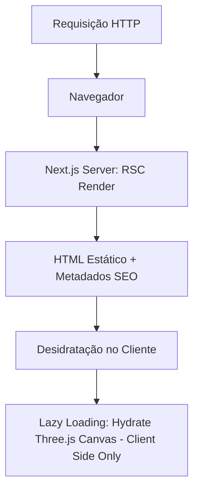

# Architecture Decision Records (ADRs)

Este documento centraliza as decisões arquiteturais tomadas para o projeto do Site Principal do Grupo 3G, detalhando o contexto, alternativas consideradas e implicações de cada escolha.

---

## ADR 001: Arquitetura Next.js App Router e Server Components

### Contexto
O site precisa de excelente desempenho em SEO (Search Engine Optimization) e carregamento inicial extremamente rápido para atrair e qualificar clientes corporativos. No entanto, as páginas internas exibem modelos 3D complexos que requerem manipulação no lado do cliente.

### Decisão
Adotamos o **Next.js 14/15 App Router** com foco em **React Server Components (RSC)** por padrão.

### Consequências
- **Positivas**:
  - SEO excelente: Toda a informação descritiva de produtos, cabeçalhos, títulos e dados estruturados (JSON-LD) é renderizada no servidor e entregue como HTML puro.
  - Redução drástica do First Contentful Paint (FCP) inicial.
- **Negativas**:
  - Aumenta a complexidade de desenvolvimento, pois exige a demarcação estrita de fronteiras de componentes cliente (`"use client"`) para os sub-componentes que renderizam as cenas 3D.

---

## ADR 002: Renderização de Modelos 3D com React Three Fiber (R3F) vs Vanilla WebGL

### Contexto
O site necessita de scrollytelling 3D interativo de alta fidelidade para demonstrar o design mecânico dos produtos (luminárias). A equipe de desenvolvimento precisa codificar essas interações de forma produtiva, testável e manutenível.

### Alternativas Consideradas
1. **Vanilla WebGL/Three.js**: Manipulação direta do DOM Canvas e loop de animação manual.
2. **React Three Fiber (R3F) + Drei**: Abstração declarativa em React que integra a cena ao ciclo de vida dos componentes.
3. **Spline Tool Web Components**: Renderização via iframe ou exportação directa de biblioteca de terceiros.

### Decisão
Decidimos por **React Three Fiber (R3F) + Drei** devido à sua modularidade e excelente integração com o ecossistema React.

### Consequências
- **Positivas**:
  - **Produtividade**: Permite declarar câmeras, luzes e malhas como tags React (`<ambientLight />`, `<mesh />`), simplificando a composição da cena.
  - **Scroll Integrado**: O uso de utilitários como `<ScrollControls>` do Drei permite amarrar a timeline de animações do modelo 3D ao scroll nativo de forma extremamente declarativa.
  - **Lazy Loading facilitado**: Componentes R3F podem ser importados dinamicamente via `next/dynamic` apenas quando entram na viewport (`[[PRD#Performance & Web Vitals (P0)|NFR - Lazy Loading]]`).
- **Negativas**:
  - Sobrecarga (overhead) no tamanho do bundle javascript (cerca de ~150KB gzip somando Three.js + R3F), exigindo uma rigorosa política de lazy loading para mitigar atrasos no LCP.

---

## ADR 003: Armazenamento e Compressão de Assets 3D (GLTF/GLB)

### Contexto
Cada arquivo 3D gerado pelo time de design em formato GLTF/GLB possui alta contagem de polígonos e materiais pesados, gerando arquivos de 10MB a 35MB. Isso viola os `[[PRD#Performance & Web Vitals (P0)|Requisitos Não Funcionais (NFRs)]]` de performance de carregamento (< 2MB).

### Decisão
Implementar um pipeline obrigatório de pré-processamento de modelos 3D usando compressão **Draco** e simplificação de malha via `gltf-pipeline` e `gltfjsx` antes de commitar no repositório.

### Consequências
- **Positivas**:
  - Redução de até 90% no peso do arquivo final.
  - Economia de banda de rede do servidor e carregamento quase instantâneo para o usuário.
- **Negativas**:
  - Exige que os desenvolvedores tenham ferramentas Node cli locais instaladas (`gltf-pipeline`) ou usem um script de conversão durante a esteira de build (`[[tasks#TASK-002: Desenvolvimento do Core de Scrollytelling 3D|TASK-002]]`).
  - Ligeira perda de detalhes microscópicos da luminária, que é imperceptível na visualização web standard.

---

## ADR 004: Engenharia e Otimização de Vídeos Web de Alta Performance

### Contexto
O site substitui e complementa malhas 3D por mídias em vídeo de alta definição para apresentação de produtos (linha Natal, Iluminação Solar, EBRON e institucional). Contudo, a reprodução de múltiplos vídeos em navegadores móveis enfrenta desafios severos: políticas rígidas de autoplay no iOS/Safari (Modo de Baixo Consumo), consumo desnecessário de CPU/GPU com múltiplos players rodando simultaneamente, fundos brancos opacos recortados e persistência de cache ao atualizar arquivos em disco.

### Decisão
Estabelecer um padrão unificado de arquitetura e aplicação de vídeos (`[[video-architecture|video-architecture.md]]`):
1. **Autoplay Resiliente**: Uso sistemático do hook `useAutoplayVideo`, que garante propriedades `muted`/`defaultMuted` nativas antes do `.play()` e ativação reativa silenciosa no primeiro gesto (`touchstart`, `pointerdown`, `scroll`).
2. **Integração Visual sem Canal Alfa**: Uso da classe CSS `mix-blend-multiply` com fundo base sincronizado e máscara de gradiente (`maskImage`) para integrar vídeos de produto com fundo branco puro diretamente na página, evitando arquivos WebM pesados e incompatíveis.
3. **Pilha de Vídeos Econômica para Configuradores**: No componente `ProductColorVideo`, empilhar vídeos de cada cor, mantendo ativos apenas `video.play()` da cor selecionada e `video.pause()` nos demais, com transições em crossfade (`transition-[opacity,transform,filter]`) e ARIA tablist acessível.
4. **Mascaramento Dinâmico em Shader/CSS**: No `SolarBackground`, alternar entre vídeos diurno e noturno via `WebkitMaskImage` controlado pelo scroll do usuário.
5. **Cache-Busting em Build Time**: Uso da função `versioned()` com base no `mtime` dos arquivos em `public/`, prevenindo entrega de mídia obsoleta.

### Consequências
- **Positivas**:
  - Autoplay infalível no ecossistema iOS e Android sem botões de play invasivos.
  - Baixíssimo consumo de memória e bateria em dispositivos móveis.
  - Fidelidade visual premium sem necessidade de renderização 3D contínua.
- **Negativas**:
  - Requer que vídeos para o modo `mix-blend-multiply` tenham fundo branco perfeitamente estourado (#FFFFFF).
  - Vídeos volumosos devem ser transferidos manualmente para a VPS em diretório ignorado pelo Git.

---

## ADR 005: Home cinematográfica — hero em sequência de vídeos e mosaico de aplicações

<!-- AUTO-GENERATED: baseado em app/page.tsx, components/HeroReel.tsx, components/MosaicGallery.tsx, lib/homeMosaic.ts -->

### Contexto
A home precisava ficar mais próxima das referências escolhidas (Citadel, Prime, Anduril): hero imersivo, mosaico de fotos e vídeos em tamanhos diferentes e navegação discreta, mantendo a paleta da empresa. A empresa vende **somente iluminação** (nunca estrutura) e, na época de Natal, a linha natalina tem prioridade.

### Decisão
1. **Hero em sequência de vídeos** (`HeroReel`): vários vídeos horizontais em tela cheia, 5 s cada, com miniaturas clicáveis e barra de progresso. Só o vídeo atual e o próximo são baixados. Com `prefers-reduced-motion` fica só a capa, sem troca automática.
2. **Mosaico de aplicações** (`MosaicGallery` + `lib/homeMosaic.ts`): cada linha tem tiles de proporções diferentes com a mesma altura (desktop); no celular a grade tem 2 colunas, tiles largos ocupam a linha toda e os verticais usam 3:4, para não haver lacunas. A primeira linha é a do Natal.
3. **Cada tile leva à marca do produto**: tiles de Natal vão para `/natal`; iluminação pública e campos de futebol vão para `/3g`.
4. **Tipografia da home**: `Inter Tight` aplicada só na home (as demais páginas ainda usam Poppins — ver pendência abaixo).

### Regras de mídia (decididas pelo responsável do site)
- Só entra na página a mídia que a empresa escolheu; nada de fotos de outras pastas.
- Não extrair quadros de vídeo para usar como foto (quadro só como capa do próprio vídeo).
- Hero: somente vídeos horizontais que preenchem a tela, em Full HD (1920×1080, H.264, `crf 20`, `faststart`, sem áudio). Mosaico: clipes de 1600 px, `crf 23`.
- Vídeos longos são cortados (o hero só toca o começo de cada um).
- Não inventar nomes de obras nem legendas; títulos dos tiles são descrições genéricas até a empresa informar os reais.

### Consequências
- **Positivas**: home imersiva e leve (poucos vídeos baixados por vez); layout sem lacunas em celular e desktop.
- **Negativas/pendências**: legendas reais dos tiles; revisão de legibilidade do texto do hero sobre o vídeo claro do estádio; imagens de "story" com texto embutido.

---

## ADR 006: Barra de navegação única com dois modos

<!-- AUTO-GENERATED: baseado em components/GroupNavbar.tsx e nas páginas que o usam -->

### Contexto
Havia três barras diferentes (`GroupNavbar` na home, `Navbar` vermelha nas páginas 3G/Natal/Sobre/produtos e `EbronNavbar` azul na EBRON), o que dava a impressão de sites separados.

### Decisão
Um único componente, `components/GroupNavbar.tsx`, com:
- `variant="overlay"`: fixa e transparente sobre um hero escuro; ao rolar mais de 24 px ganha fundo sólido. Usado na home.
- `variant="solid"`: fundo sólido e fixa no topo (`sticky`). Usado em `/3g`, `/natal`, `/natal/[categoria]`, `/sobre`, `/produtos/*` e nas páginas da EBRON.
- `tone="red" | "navy"`: cor do fundo (vermelho do Grupo 3G ou azul-marinho da EBRON). O botão CONTATO inverte para branco quando a barra tem fundo.
- Links: INÍCIO, NATAL, 3G, EBRON, SOBRE e o botão CONTATO (WhatsApp). A logo leva sempre para `/`. O menu do celular fecha com Esc.

### Consequências
- **Positivas**: navegação consistente em todo o site; um só lugar para manter links e acessibilidade.
- **Pendências**: `components/Navbar.tsx` e `components/ebron/EbronNavbar.tsx` ficaram sem uso e podem ser removidos; para o `/natal` usar `overlay`, o hero precisa deixar de ser cinza-claro.

### Atualização (revisão Web Interface Guidelines)
- Links internos da barra usam `next/link` (sem recarregar a página); só o CONTATO é `<a target="_blank">`.
- O fechamento do menu do celular ficou no próprio link, e os links têm estilo de foco visível.
- `app/layout.tsx` exporta `viewport` com `themeColor: "#b12b30"` (brand-red) e `viewportFit: "cover"`, necessário para `env(safe-area-inset-*)` funcionar.
