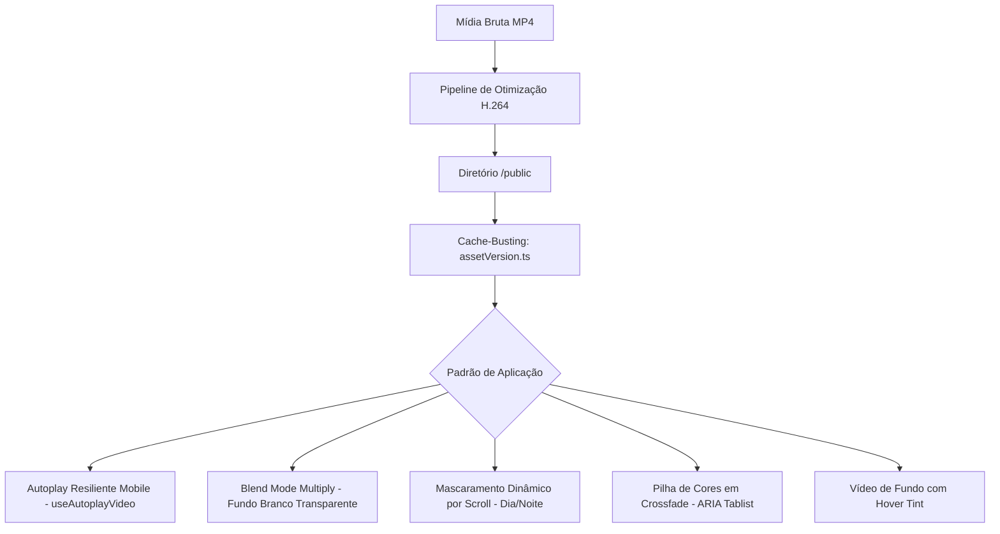

# Arquitetura de Mídia e Vídeos de Alta Performance

Este documento estabelece as especificações arquiteturais, padrões de engenharia e diretrizes de implementação para recursos de vídeo no **Site Principal do Grupo 3G**.

---

## 1. Visão Geral da Camada de Mídia

Os vídeos no sistema cumprem três funções estratégicas:
1. **Showcase Dinâmico de Engenharia e Produto**: Substituição de modelos 3D pesados por reproduções contínuas em alta definição com baixíssimo consumo de hardware.
2. **Interatividade de Catálogo (Configurador)**: Demonstração de tonalidades, temperaturas de cor e efeitos visuais sem recarregamento de página.
3. **Imersão Institucional e Scrollytelling**: Planos de fundo imersivos, portas de transição de marca e scrollytelling atrelado à rolagem do usuário.



---

## 2. Padrões de Aplicação no Código

### 2.1 Autoplay Resiliente em Dispositivos Móveis e Safari (`useAutoplayVideo`)
- **Problema**: O React nem sempre reflete o atributo JSX `muted` na propriedade nativa do elemento DOM antes de o navegador avaliar sua política de autoplay. No iOS e navegadores móveis (especialmente sob Modo de Baixo Consumo), isso trava o vídeo ou exibe controles nativos indesejados.
- **Solução Arquitetural**: O hook [`useAutoplayVideo`](file:///d:/PROJETOS/Site%20Principal-FIEC/next-site/hooks/useAutoplayVideo.ts) força explicitamente `video.muted = true` e `video.defaultMuted = true` no elemento nativo via `ref` antes de disparar `.play()`.
- **Estratégia de Fallback Suave**: Adiciona ouvintes passivos com descarte automático (`touchstart`, `pointerdown`, `scroll`) no objeto `window`. Qualquer interação com a página inicia imediatamente a reprodução de forma silenciosa, sem exigir toque direto no vídeo.

### 2.2 Integração Transparente de Fundo via Blend Mode (`ProductVideoHero`)
- **Problema**: Vídeos de produto com fundo branco removido (ex: exportações do Canva ou estúdio) criam caixas visíveis quando colocados sobre páginas web. Vídeos com canal alfa nativo (WebM / ProRes) geram arquivos gigantescos ou apresentam incompatibilidade com Safari iOS.
- **Solução Arquitetural**: Aplicada em [`ProductVideoHero.tsx`](file:///d:/PROJETOS/Site%20Principal-FIEC/next-site/components/natal/ProductVideoHero.tsx):
  - Fundo do container configurado na mesma tonalidade base (`bg-[#f3f3f3]`).
  - Utilização da classe CSS `mix-blend-multiply` no elemento `<video>`. Os pixels brancos multiplicam-se para neutralidade, fundindo perfeitamente o produto ao layout.
  - Aplicação de máscara vertical em gradiente (`WebkitMaskImage` / `maskImage: linear-gradient(to bottom, transparent 0%, black 8%, black 88%, transparent 100%)`) para suavização das extremidades superior e inferior.

### 2.3 Duplo Vídeo com Mascaramento Interativo Baseado em Scroll (`SolarBackground`)
- **Técnica**: Aplicada em [`SolarBackground.tsx`](file:///d:/PROJETOS/Site%20Principal-FIEC/next-site/components/SolarBackground.tsx):
  - Dois elementos `<video>` fixos em loop contínuo: diurno (`solar.mp4`) e noturno (`solar noite.mp4`).
  - A propriedade CSS `WebkitMaskImage` da camada noturna é calculada em tempo real com base no percentual de rolagem (`scrollPercent`) e no tema ativo (`light` ou `dark`).
  - Transição acelerada por GPU sem recarregar ou travar os fluxos de vídeo.

### 2.4 Configurador de Cores em Pilha com Transição Crossfade (`ProductColorVideo`)
- **Técnica**: Aplicada em [`ProductColorVideo.tsx`](file:///d:/PROJETOS/Site%20Principal-FIEC/next-site/components/natal/ProductColorVideo.tsx):
  - Stack de múltiplos elementos `<video>` absolutos, um para cada SKU de cor da luminária.
  - **Eficiência Energética**: Apenas o vídeo da cor selecionada mantém `video.play()` ativo. Todos os demais são pausados via `video.pause()` para economizar CPU, GPU e bateria em smartphones.
  - **Estratégia de Pré-carregamento**: O primeiro elemento utiliza `preload="auto"`; as cores alternativas utilizam `preload="metadata"`.
  - **Efeito Visual**: Transição em `transition-[opacity,transform,filter]` com leve zoom e desfoque (`scale-105`, `blur-[2px]`) nos vídeos inativos, complementado por flash de luz (`motion-safe:animate-[color-flash_0.6s_ease-out]`).
  - **Acessibilidade**: Estruturado como `role="tablist"` com suporte completo a roving tabindex via setas direcionais (`ArrowLeft` / `ArrowRight`), anúncio em leitor de tela via `role="status" aria-live="polite"` e áreas de toque com no mínimo 44px (`min-h-11`).

### 2.5 Scrollytelling e Painéis de Categorias (`ScrollScrubPanel`)
- **Técnica**: Aplicada em [`ScrollScrubPanel.tsx`](file:///d:/PROJETOS/Site%20Principal-FIEC/next-site/components/natal/ScrollScrubPanel.tsx):
  - Integração com Framer Motion (`useScroll`, `useTransform`) conectando a escala do vídeo (`imageScale`) ao progresso do scroll do usuário (`[1.18, 1]`).
  - Responsividade dinâmica: no mobile, o vídeo ocupa todo o painel com degradê protetor para o texto; no desktop, transforma-se em coluna lateral contida (`mediaAlign="left" | "right"`).

### 2.6 Background Institucional com Véu Interativo de Marca (`GroupHome`, `HeroSlider`, `EbronHeroSlider`)
- **Técnica**: Aplicada em [`app/page.tsx`](file:///d:/PROJETOS/Site%20Principal-FIEC/next-site/app/page.tsx), [`HeroSlider.tsx`](file:///d:/PROJETOS/Site%20Principal-FIEC/next-site/components/HeroSlider.tsx) e [`EbronHeroSlider.tsx`](file:///d:/PROJETOS/Site%20Principal-FIEC/next-site/components/ebron/EbronHeroSlider.tsx):
  - Vídeos operando com opacidade calibrada (`opacity-40` a `opacity-55`) sob véus coloridos das marcas (`bg-brand-red`, `bg-ebron-blue`).
  - Transição de estado: nas portas da home do Grupo, o hover (`group-hover:opacity-0`) remove a máscara de cor, revelando o vídeo limpo em full contrast.

---

## 3. Preload e Estratégia de Cache-Busting

### 3.1 Preload no Head HTML
Para vídeos críticos exibidos acima da dobra (above-the-fold), injeta-se o cabeçalho de antecipação:
```html
<link rel="preload" href="/natal/videos/arvore.mp4" as="video" type="video/mp4" />
```
Isso permite ao navegador iniciar o download e decoding do stream antes do parser alcançar o nó no DOM.

### 3.2 Cache-Busting Automático via Mtime (`assetVersion.ts`)
A função [`versioned`](file:///d:/PROJETOS/Site%20Principal-FIEC/next-site/lib/natal/assetVersion.ts) insere automaticamente uma query string calculada com a data de modificação física do arquivo (`?v=<mtimeMs>`):
- Executado em build time para rotas estáticas.
- Evita que novas versões de vídeos substituídos na pasta `public/` continuem sendo servidas pelo cache persistente do navegador ou por proxies intermediários.

---

## 4. Diretrizes Técnicas para Novos Vídeos

Ao produzir e cadastrar novos arquivos de vídeo no repositório ou servidor:

1. **Formato e Codec**:
   - Container: `.mp4`
   - Codec de Vídeo: H.264 (AVC) — perfil Main ou High.
   - Áudio: **Remover a trilha de áudio** na exportação para economizar banda e garantir autoplay irrestrito.
2. **Resolução e Taxa de Bits (Bitrate)**:
   - Vídeos de Fundo (Hero/Background): 1920x1080, máximo 2.5 Mbps, 30 fps.
   - Vídeos de Produto / Cores (Configurador): 1080x1080 ou 1920x1080, 1.5 a 2.0 Mbps, 30 fps.
   - Vídeos Mobile Curtos: 720p, até 1.2 Mbps.
3. **Localização de Arquivos**:
   - Os arquivos de vídeo residem em `public/` (ex: `public/natal/videos/`, `public/models/`).
   - Arquivos muito pesados devem ser ignorados no `.gitignore` e enviados diretamente para o diretório `/var/www/3giluminacao/public/` na VPS Ubuntu.
