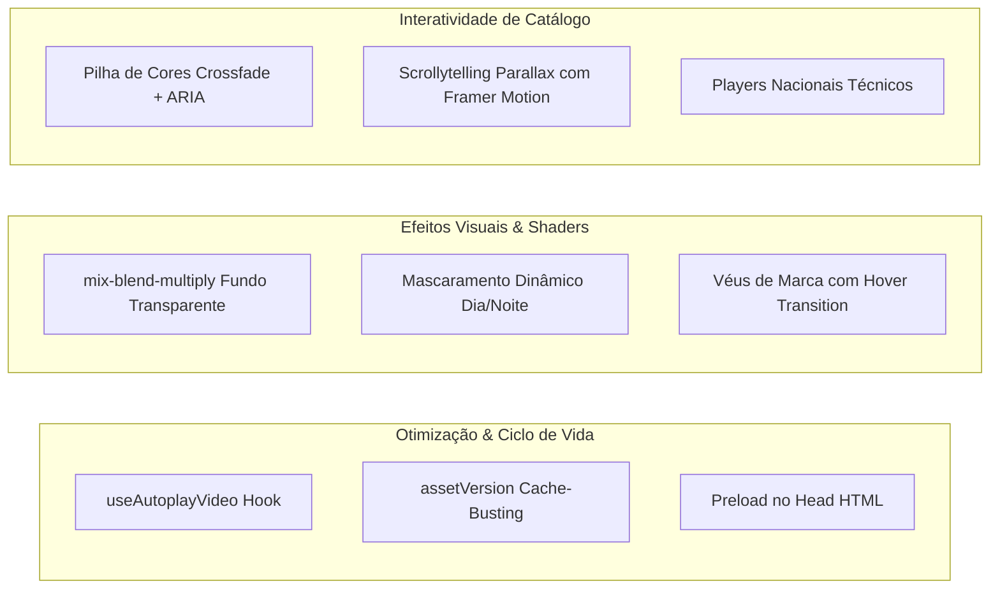

# Grupo 3G — Site Principal & Catálogo Digital

Plataforma digital institucional e catálogo interativo das marcas **Grupo 3G**, **3G Iluminação**, **EBRON** e linha **Natal 3G**. O sistema combina renderizações 3D em tempo real e engenharia de vídeo avançada para demonstrar produtos de iluminação pública, industrial e decorativa com alta fidelidade e performance extrema.

---

## 1. Visão Geral e Arquitetura

O projeto é construído sobre o ecossistema moderno do **Next.js (App Router)** com arquitetura híbrida:
- **Server Components (RSC)**: Renderização server-side padrão para metadados, estrutura de SEO (JSON-LD), acessibilidade e carregamento inicial quase instantâneo (FCP baixo).
- **Client Components (`"use client"`)**: Isolamento estrito de componentes interativos que manipulam o DOM Canvas (Three.js/R3F), Framer Motion e controles de mídia nativos (`<video>`).
- **Design System & Estilização**: Tailwind CSS com paleta institucional tokenizada (`brand-red`, `ebron-navy`, `ebron-blue-light`, `natal-gold`, `natal-red`).
- **Separação de Preocupações (Separation of Concerns)**: Hooks desacoplados para lógica de mídia e autoplay, catálogos e esquemas de dados isolados em `lib/`, e componentes reutilizáveis.

---

## 2. Guia de Engenharia e Aplicação de Vídeos

O sistema utiliza vídeos em alta definição como recurso estratégico para apresentação de produtos e efeitos visuais, substituindo ou complementando renderizações 3D com menor sobrecarga de GPU e compatibilidade universal.

Abaixo estão detalhados os 9 padrões e formas aplicadas no projeto:



### 2.1 Autoplay Resiliente em Mobile / Safari iOS (`useAutoplayVideo`)
- **Arquivo**: [`hooks/useAutoplayVideo.ts`](file:///d:/PROJETOS/Site%20Principal-FIEC/next-site/hooks/useAutoplayVideo.ts)
- **Problema**: O React nem sempre reflete o atributo JSX `muted` na propriedade nativa do elemento DOM antes de o navegador avaliar a política de autoplay. No iOS e Android (especialmente sob Modo de Pouca Energia), o autoplay é bloqueado e o player cai em fallbacks nativos indesejados.
- **Implementação**:
  - Força explicitamente `video.muted = true` e `video.defaultMuted = true` via ref antes de chamar `video.play()`.
  - Registra listeners passivos únicos para `touchstart`, `pointerdown` e `scroll`. No primeiro gesto do usuário em qualquer lugar da tela, a reprodução é disparada de modo silencioso e os listeners são removidos.

```typescript
// hooks/useAutoplayVideo.ts
export const useAutoplayVideo = <T extends HTMLVideoElement>() => {
  const ref = useRef<T | null>(null);

  useEffect(() => {
    const video = ref.current;
    if (!video) return;

    video.muted = true;
    video.defaultMuted = true;

    const tryPlay = () => video.play().catch(() => undefined);
    tryPlay();

    const retryOnce = () => {
      if (video.paused) tryPlay();
      window.removeEventListener("touchstart", retryOnce);
      window.removeEventListener("pointerdown", retryOnce);
      window.removeEventListener("scroll", retryOnce);
    };

    window.addEventListener("touchstart", retryOnce, { passive: true });
    window.addEventListener("pointerdown", retryOnce, { passive: true });
    window.addEventListener("scroll", retryOnce, { passive: true });

    return () => {
      window.removeEventListener("touchstart", retryOnce);
      window.removeEventListener("pointerdown", retryOnce);
      window.removeEventListener("scroll", retryOnce);
    };
  }, []);

  return ref;
};
```

---

### 2.2 Integração Transparente de Vídeo via Blend Mode (`ProductVideoHero`)
- **Arquivo**: [`components/natal/ProductVideoHero.tsx`](file:///d:/PROJETOS/Site%20Principal-FIEC/next-site/components/natal/ProductVideoHero.tsx)
- **Problema**: Vídeos de produto gravados ou tratados com fundo branco estourado criam caixas e recortes rígidos sobre o fundo da página. Formatos com canal alfa nativo (WebM / ProRes) geram arquivos excessivamente pesados e são incompatíveis com o Safari no iOS.
- **Solução Aplicada**:
  - O container utiliza o fundo correspondente (`bg-[#f3f3f3]`).
  - O `<video>` recebe a classe CSS `mix-blend-multiply`. Todos os pixels brancos multiplicam-se para neutralidade, integrando o produto diretamente ao layout sem molduras.
  - Uma máscara CSS em gradiente linear suaviza as extremidades superior e inferior:

```tsx
<video
  ref={videoRef}
  src={videoSrc}
  poster={posterSrc}
  muted
  loop
  playsInline
  autoPlay
  aria-hidden
  className="h-full w-full max-h-[94vh] max-w-[1120px] object-contain mix-blend-multiply pointer-events-auto"
  style={{
    WebkitMaskImage: "linear-gradient(to bottom, transparent 0%, black 8%, black 88%, transparent 100%)",
    maskImage: "linear-gradient(to bottom, transparent 0%, black 8%, black 88%, transparent 100%)",
  }}
/>
```

---

### 2.3 Duplo Vídeo com Mascaramento Interativo Baseado em Scroll (`SolarBackground`)
- **Arquivo**: [`components/SolarBackground.tsx`](file:///d:/PROJETOS/Site%20Principal-FIEC/next-site/components/SolarBackground.tsx)
- **Técnica**: Transição contínua entre cenário diurno e noturno acionada pela rolagem do usuário na página da Luminária Solar.
- **Implementação**:
  - Dois elementos `<video>` empilhados em camada fixa (`fixed inset-0 pointer-events-none`): vídeo diurno (`solar.mp4`) na base e vídeo noturno (`solar noite.mp4`) sobreposto.
  - A propriedade `WebkitMaskImage` do vídeo superior é recalculada dinamicamente conforme o percentual de scroll (`scrollPercent`) e tema (`light`/`dark`), criando uma faixa suave de transição de 30% acelerada pela GPU.

```tsx
const splitPercent = theme === "dark" ? -20 : Math.max(-20, 110 - scrollPercent * 10);

const maskStyle: React.CSSProperties = {
  WebkitMaskImage: `linear-gradient(to right, transparent ${splitPercent - 15}%, black ${splitPercent + 15}%)`,
  maskImage: `linear-gradient(to right, transparent ${splitPercent - 15}%, black ${splitPercent + 15}%)`,
  transition: "mask-image 0.8s cubic-bezier(0.16, 1, 0.3, 1), -webkit-mask-image 0.8s cubic-bezier(0.16, 1, 0.3, 1)",
};
```

---

### 2.4 Configurador de Cores em Pilha com Transição Crossfade (`ProductColorVideo`)
- **Arquivo**: [`components/natal/ProductColorVideo.tsx`](file:///d:/PROJETOS/Site%20Principal-FIEC/next-site/components/natal/ProductColorVideo.tsx)
- **Técnica**: Configurador estilo automotivo onde o usuário alterna cores e tonalidades do produto (Branco Quente, Verde, Vermelho, Azul, Multicolorido) com transições visuais instantâneas.
- **Eficiência e Gestão de Recursos**:
  - Todos os vídeos de cada cor são pré-montados no DOM com sobreposição absoluta.
  - **Apenas o vídeo ativo executa `video.play()`**; todos os vídeos inativos são mantidos em `video.pause()`, eliminando consumo de CPU e bateria em dispositivos móveis.
  - Carregamento seletivo: `preload={i === 0 ? "auto" : "metadata"}`.
  - Efeito de transição cruzada (`crossfade`) com leve escala e desfoque (`scale-105 blur-[2px]`) nos inativos.
  - Flash de iluminação via animação CSS pura (`motion-safe:animate-[color-flash_0.6s_ease-out]`).
  - **Acessibilidade Plena**: Grupo estruturado com `role="tablist"`, navegação por setas do teclado (roving tabindex), anúncio em leitor de tela via `role="status" aria-live="polite"` e áreas de toque com mínimo de 44px.

---

### 2.5 Scrollytelling e Zoom Adaptativo de Categoria (`ScrollScrubPanel`)
- **Arquivo**: [`components/natal/ScrollScrubPanel.tsx`](file:///d:/PROJETOS/Site%20Principal-FIEC/next-site/components/natal/ScrollScrubPanel.tsx)
- **Técnica**: Vincula a escala e o enquadramento do vídeo à posição de rolagem via Framer Motion (`useScroll`, `useTransform`).
- **Responsividade e Comportamento**:
  - Prioridade automática: quando um vídeo está configurado, substitui a foto estática.
  - No mobile, o vídeo opera full-bleed com degradê escuro inferior para proteção do texto.
  - No desktop, organiza-se em colunas divididas (`mediaAlign="left" | "right"`), ajustando a escala (`[1.18, 1]` ou `[1.1, 1]`) com contenção total sem corte de produto.

---

### 2.6 Background Institucional com Véu Interativo de Marca (`GroupHome`, `HeroSlider`, `EbronHeroSlider`)
- **Arquivos**:
  - [`app/page.tsx`](file:///d:/PROJETOS/Site%20Principal-FIEC/next-site/app/page.tsx)
  - [`components/HeroSlider.tsx`](file:///d:/PROJETOS/Site%20Principal-FIEC/next-site/components/HeroSlider.tsx)
  - [`components/ebron/EbronHeroSlider.tsx`](file:///d:/PROJETOS/Site%20Principal-FIEC/next-site/components/ebron/EbronHeroSlider.tsx)
- **Técnica**: Vídeos de fundo com baixa opacidade (`opacity-40` a `opacity-55`) sobrepostos por véus de gradiente que carregam as cores institucionais de cada marca.
- **Microinteração**: Nas portas da Home do Grupo, o hover (`group-hover:opacity-0`) desfaz a camada de tinting de marca, exibindo o vídeo limpo com brilho e contraste totais.

---

### 2.7 Cache-Busting Baseado em Mtime (`assetVersion.ts`)
- **Arquivo**: [`lib/natal/assetVersion.ts`](file:///d:/PROJETOS/Site%20Principal-FIEC/next-site/lib/natal/assetVersion.ts)
- **Técnica**: Ao substituir arquivos de vídeo em `public/` preservando os mesmos nomes de arquivo, navegadores e CDNs costumam manter cópias antigas em cache.
- **Implementação**: A função `versioned(src)` insere a query string `?v=<mtimeMs>` calculada a partir do timestamp de modificação no disco (`statSync`).
  - Executa em build time com cache em memória.
  - Invalida automaticamente qualquer camada de cache ao trocar o arquivo físico sem necessidade de renomear referências manuais.

---

### 2.8 Preload de Mídia Crítica no Cabeçalho HTML
- **Arquivo**: [`app/page.tsx`](file:///d:/PROJETOS/Site%20Principal-FIEC/next-site/app/page.tsx#L18)
- **Técnica**: Vídeos prioritários de abertura recebem pré-carregamento no `<head>`:
```html
<link rel="preload" href="/natal/videos/arvore.mp4" as="video" type="video/mp4" />
```
Isso instrui o navegador a inicializar a conexão de rede e o download dos primeiros fragmentos antes da execução do parser do DOM.

---

### 2.9 Apresentação Técnica e Demonstração com Controles Nativos
- **Arquivos**:
  - [`components/VideoFeatureSection.tsx`](file:///d:/PROJETOS/Site%20Principal-FIEC/next-site/components/VideoFeatureSection.tsx)
  - [`app/produtos/luminaria-solar/page.tsx`](file:///d:/PROJETOS/Site%20Principal-FIEC/next-site/app/produtos/luminaria-solar/page.tsx#L365-L375)
- **Técnica**: Demonstração de ensaios laboratoriais e características de fabricação em players contidos com proporção estrita, sombras de destaque, pôster de carregamento (`poster="/3G VETOR branco.png"`) e controles nativos completos (`controls`).

---

## 3. Diretrizes para Novos Vídeos

Para inclusão de novos vídeos no projeto, seguir as especificações:

| Tipo de Aplicação | Resolução Recomendada | Codec | Taxa de Bits (Bitrate) | Áudio |
| :--- | :--- | :--- | :--- | :--- |
| **Hero / Fundo Institucional** | 1920x1080 (16:9) | H.264 (MP4) | 2.0 a 2.5 Mbps | Sem faixa de áudio |
| **Configurador de Produto / Cores** | 1080x1080 ou 1920x1080 | H.264 (MP4) | 1.5 a 2.0 Mbps | Sem faixa de áudio |
| **Mobile Scrollytelling** | 1080x1920 ou 720p | H.264 (MP4) | 1.0 a 1.5 Mbps | Sem faixa de áudio |
| **Vídeo Técnico / Laboratório** | 1920x1080 (16:9) | H.264 (MP4) | 3.0 a 4.0 Mbps | Estéreo AAC se narrado |

> [!TIP]
> **Dica de Renderização**: Para vídeos que utilizam `mix-blend-multiply` (como no Hero da linha Natal), o fundo do produto no vídeo deve ser branco absoluto (`#FFFFFF` / RGB 255, 255, 255). Qualquer tom acinzentado causará sombra indesejada sobre a página.

---

## 4. Estrutura de Diretórios

```text
next-site/
├── app/                        # Next.js App Router
│   ├── layout.tsx              # Shell global, fontes e metadados
│   ├── page.tsx                # Home do Grupo 3G (Hero e Portas de Marca)
│   ├── natal/                  # Catálogo completo Natal 3G
│   │   ├── page.tsx            # Hub Natal com Hero de vídeo e lineup
│   │   └── [category]/         # Páginas dinâmicas por categoria de produto
│   └── produtos/               # Páginas técnicas de produtos industriais
│       ├── luminaria-solar/    # Página da Solar com vídeo dia/noite e 3D
│       ├── luminaria-homologada/
│       └── ebron/
├── components/                 # Componentes reutilizáveis
│   ├── HeroSlider.tsx          # Carrossel da 3G Iluminação com vídeo de fundo
│   ├── SolarBackground.tsx     # Duplo vídeo com máscara linear por scroll
│   ├── VideoFeatureSection.tsx # Seção técnica com player e controles
│   ├── natal/                  # Componentes dedicados à linha Natal
│   │   ├── ProductVideoHero.tsx# Hero de produto com blend-multiply
│   │   ├── ProductColorVideo.tsx# Configurador de cores com crossfade
│   │   └── ScrollScrubPanel.tsx# Painel parallax integrado ao scroll
│   └── ebron/                  # Componentes da linha EBRON
├── deploy/                     # Configurações de infraestrutura Linux
│   └── nginx-3giluminacao.conf # Configuração Nginx para proxy reverso
├── ecosystem.config.js         # Configuração de processos PM2
├── hooks/                      # Hooks customizados
│   ├── useAutoplayVideo.ts     # Hook mestre de autoplay resiliente
│   └── useProductHeroReveal.ts # Hook de reveal e transição
├── lib/                        # Esquemas de dados, catálogos e helpers
│   ├── natalCatalog.ts         # Catálogo de produtos e definições de mídia
│   └── natal/
│       └── assetVersion.ts     # Cache-buster baseado no mtime físico
└── public/                     # Mídias estáticas servidas diretamente
    ├── natal/videos/           # Vídeos de produtos e cores de Natal
    ├── models/                 # Modelos 3D (.glb) e vídeos da linha Solar
    └── hdri/                   # Iluminação ambiente para cenas 3D
```

---

## 5. Desenvolvimento Local

```bash
# 1. Instalar dependências
npm install

# 2. Executar em modo de desenvolvimento
npm run dev

# 3. Validar build de produção e tipagem estrita
npm run build
```

---

## 6. Ambiente de Produção (Linux Ubuntu + Nginx + PM2)

A hospedagem do projeto segue a arquitetura recomendada para ambiente Linux (Ubuntu) utilizando gerenciamento com PM2 e proxy reverso com Nginx:

### 6.1 Gerenciamento de Processos via PM2
O arquivo [`ecosystem.config.js`](file:///d:/PROJETOS/Site%20Principal-FIEC/next-site/ecosystem.config.js) gerencia a aplicação em modo cluster/fork na porta interna `3010`:

```bash
# Iniciar a aplicação em produção
pm2 start ecosystem.config.js

# Salvar o estado para reinício automático do servidor
pm2 save

# Visualizar logs em tempo real
pm2 logs 3giluminacao
```

### 6.2 Proxy Reverso no Nginx
A configuração está disponível em [`deploy/nginx-3giluminacao.conf`](file:///d:/PROJETOS/Site%20Principal-FIEC/next-site/deploy/nginx-3giluminacao.conf):

```nginx
server {
    listen 80;
    listen [::]:80;
    server_name 3giluminacao.com.br www.3giluminacao.com.br;

    location / {
        proxy_pass http://127.0.0.1:3010;
        proxy_http_version 1.1;
        proxy_set_header Upgrade $http_upgrade;
        proxy_set_header Connection "upgrade";
        proxy_set_header Host $host;
        proxy_set_header X-Real-IP $remote_addr;
        proxy_set_header X-Forwarded-For $proxy_add_x_forwarded_for;
        proxy_set_header X-Forwarded-Proto $scheme;
        proxy_cache_bypass $http_upgrade;
    }

    client_max_body_size 50M;
}
```

### 6.3 Gestão de Arquivos Pesados em Produção
Arquivos volumosos de vídeo (`.mp4`) e modelos 3D (`.glb`) ignorados pelo Git devem ser sincronizados diretamente para o diretório `/var/www/3giluminacao/public/` na VPS via SCP ou RSYNC, respeitando as estruturas:
- `public/natal/videos/`
- `public/models/`
- `public/photometry/`
- `public/hdri/`
